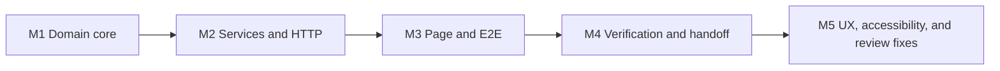

# Agent Collaboration Rules

## Primary-agent ownership

The primary agent owns task planning, shared contracts, integration decisions, documentation consistency, and final verification. It is the only writer at dependency join points.

Before changing code, read:

1. `docs/EXERCISE_BRIEF.md`: supplied requirements; do not edit them.
2. `DECISIONS.md`: selected interpretations and trade-offs.
3. `docs/DESIGN.md`: intended architecture, behavior, and evidence.
4. `CLAUDE.md`: project-level engineering constraints.

## Delegation boundary

Delegate only work that is independent, has a clear scope, relies on stable contracts, and can be reviewed before integration.

Good uses of independent agents include:

- deriving adversarial cases from the brief and invariants;
- reviewing policy specificity, age boundaries, or consent safety;
- checking an API contract against the service behavior;
- checking documentation against the verified implementation.

Do not use parallel writers for shared domain contracts, service composition, dependent API/UI work, or final integration fixes. When parallel writing is justified, assign disjoint files and rejoin through the primary agent.

### Parallelism decision

Before launching agents, decide whether parallel work is worth its coordination cost:

- Trivial work, such as a short edit, a single file, or a repair, stays with the primary agent and is not parallelized.
- Split only independent work along orthogonal angles: backend / frontend / tests, or read code / run an experiment / check documentation. If one angle is a subset of another, drop it.
- One angle per agent. Launch independent angles concurrently; serialize work that has dependencies.
- Cap concurrent agents at five. More agents than distinct angles adds cost without coverage.

### Agent briefing and independence

Every delegated prompt must stand alone. State the goal and why it matters, give file paths and what has already been tried or ruled out, define the expected output, and say whether the agent may write files or is read-only. Agents must not depend on another agent's unfinished output.

A sub-agent report is a claim, not evidence. The primary agent verifies any claim that would change a decision before relying on it.

### Background work

Long-running commands, agent runs, and large reads run in the background so the conversation stays responsive. State the plan first, then process results when they arrive. Large outputs are written to a results file and referenced by path plus a one-line summary.

## Milestones

Work proceeds one milestone at a time, and each milestone ends in human review. The first four were planned from the brief; M5 is a later user-review round with the same obligations:



1. **M1 Domain core**: shared types, policy validation and precedence, calendar age, input normalization, decision evaluation, consent state machine, and their unit tests.
2. **M2 Services and HTTP**: repository, decision and consent services, three versioned route files implementing four operations, and API tests.
3. **M3 Page and E2E**: demonstration page, presets, action matrix, demo contract tests, and the Playwright journey.
4. **M4 Verification and handoff**: remove empty-suite allowances, run the full verification ladder, reconcile documentation with delivered behavior, and verify the deployed revision.
5. **M5 Front-end UX and accessibility**: a user-review round over the M3 page: expected outcomes before selection, semantic status display, accessible controls, and the review-driven hardening recorded in `AI-USE.md`.

## Per-milestone verification and adversarial review

Every planned implementation milestone (M1–M4) ends with the same four obligations, recorded as one row in the review log in `AI-USE.md`. M5 was a later user-review round; its focused tests and findings are recorded there, but it did not add a separate mutation script.

1. **Tests for the rules the milestone introduced**, including edge cases rather than only the happy path. For this project those include age boundaries (the day before, on, and after a birthday, plus February 29), rule precedence with shuffled input, jurisdiction normalization, rejection of a client-supplied evaluation date, hard-block protection, and consent-scope isolation.
2. **A read-only adversarial reviewer agent**, run after the focused tests pass. Give it an angle that differs from the previous round, for example: derive expected age behavior from the brief, attack the API contract, or hunt for unhandled failure paths. It is read-only unless reassigned as a writer, derives expected behavior before reading the implementation, and reports evidence-backed gaps only. Its output is advisory until the primary agent and human verify it.
3. **A failing test first for every accepted defect**, then the smallest correction, then the relevant regression run.
4. **A mutation check for each new safety rule**: deliberately break the branch that enforces it and confirm at least one test fails. A rule whose removal turns nothing red is documentation, not a guard. M4's structural error classification is covered by mutation M in `tools/mutation-check-m2.sh`.

Rejected reviewer suggestions are recorded with the reason. Do not repeat the same review angle in consecutive rounds.

## Working protocol

- Group work into reviewable changes and do not silently expand the scope.
- Derive tests from requirements and invariants, not only from generated code.
- After each material change, run focused verification and inspect the diff.
- Keep commit boundaries aligned with meaningful capabilities or corrections.
- Never add credentials, secrets, or local configuration to the repository.
- Update `DECISIONS.md` when a selected design changes, including the reason.
- Update `AI-USE.md` only with material events that actually occurred.
- Keep commit hashes, verification results, and deployed-revision claims factual.

## Commands

```bash
npm ci
npm run dev
npm run test:run
npm run build
npm run test:e2e       # needs a prior npm run build and a one-time npx playwright install chromium
npm run verify
```

## Deployment contract

- `.github/workflows/ci.yml` controls CI.
- `render.yaml` defines the Render service.
- Render builds with `npm ci && npm run build` and starts with `npm start`. Auto-deploy is off; CI triggers the deploy for a verified commit through the Render API.
- Storage is in memory for this exercise. State resets after restart, redeployment, or service sleep.
- Do not add unplanned infrastructure, services, or dependencies without recording the design change first.

Compilation is not proof of business correctness; a milestone is complete only after diff review and focused verification.

<!-- BEGIN:nextjs-agent-rules -->

## This is NOT the Next.js you know

This version has breaking changes — APIs, conventions, and file structure may all differ from your training data. Read the relevant guide in `node_modules/next/dist/docs/` (resolved from this file's directory; in monorepos the `next` package may not be visible from the repo root) before writing any code. Heed deprecation notices.

This block is written and re-added by `next dev` — verify at `node_modules/next/dist/server/lib/generate-agent-files.js`. Removing it from a diff only re-creates the uncommitted change; committing it with your work keeps the tree clean.

<!-- END:nextjs-agent-rules -->
