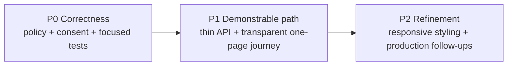
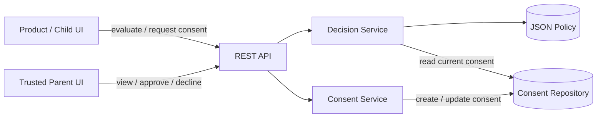
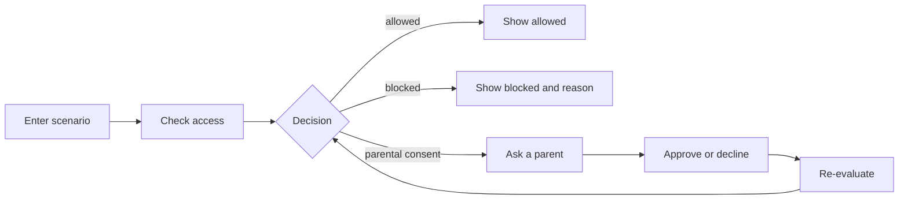
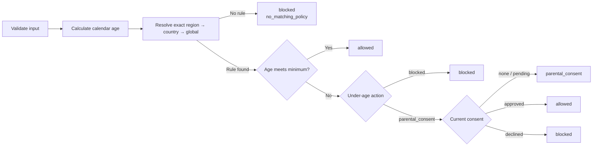
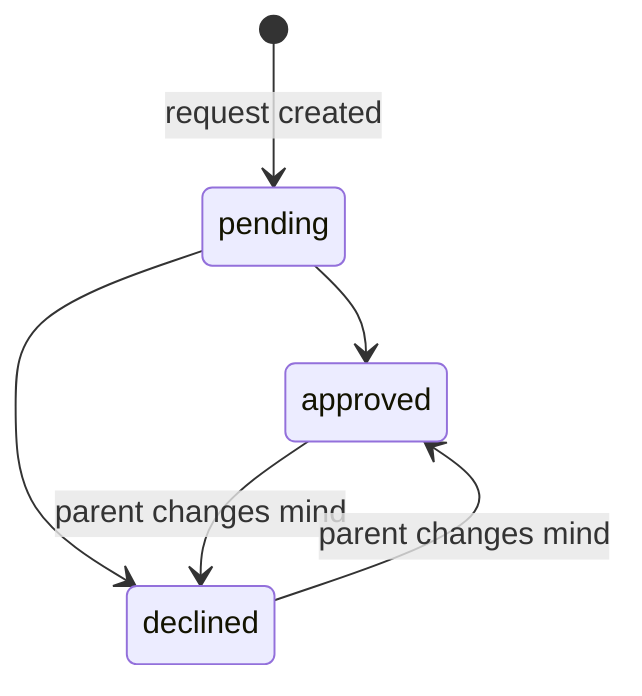
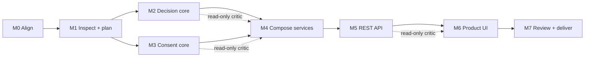
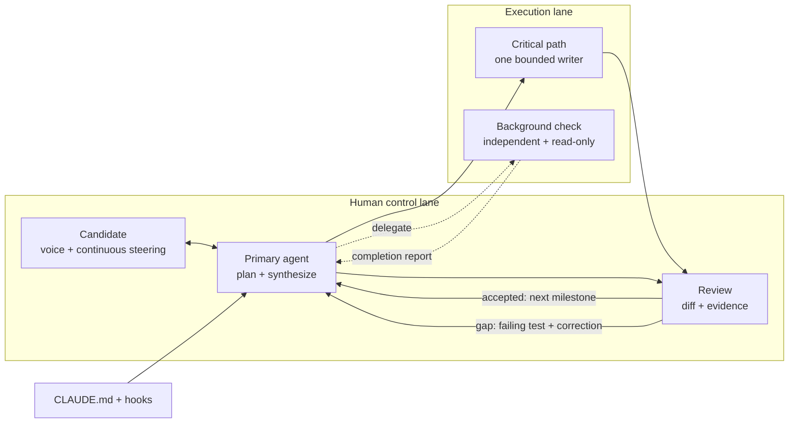
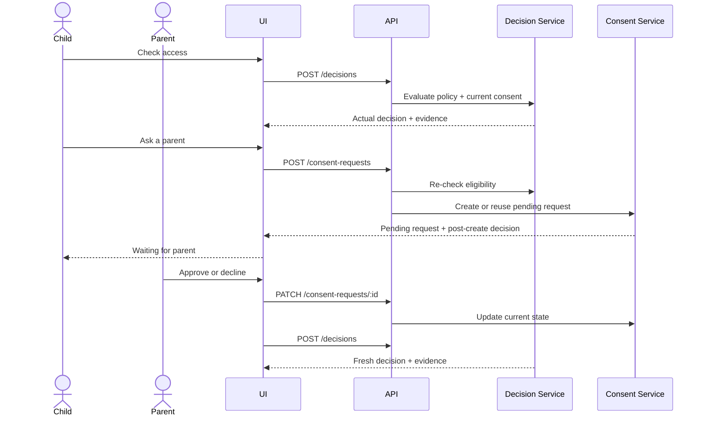

# Consent Gate — Proposed Implementation Spec

This is the proposed shared contract for the live exercise. The first ten minutes align the key decisions; implementation then proceeds in bounded AI-assisted milestones while the candidate supervises, verifies, and discusses trade-offs with the interviewer.

Nothing here is interviewer-approved until confirmed during the session. Confirmed choices and corrections must be recorded in `DECISIONS.md`; interviewer direction overrides this proposal.

## 0. Presentation map

The live walkthrough follows five stops. Detailed subsections remain implementation references for Claude Code and are opened only when relevant.

| Stop | Live topic | Show now | Buy-in required |
|---:|---|---|---|
| 1 | Product contract | Goal, time-box, semantic decisions, core invariants | Meaning and scope |
| 2 | Architecture and journey | System boundary and primary product flow | Ownership boundaries |
| 3 | Decision logic and API | Decision flow, consent states, four REST operations | Request/response payload detail |
| 4 | Quality and delivery | Risk-based test layers and critical work path | Evidence and implementation order |
| 5 | AI working model | Supervision loop and first milestone | Execution model and start |

Detailed UI, payload, and agent instructions are implementation references in the appendices; they are opened only when the corresponding milestone begins.

## 1. Requirements and alignment

### 1.1 Goal

| Input | Decision engine | Output | Stateful follow-up |
|---|---|---|---|
| `subjectId`, DOB, jurisdiction, feature | Age + most-specific policy + current consent | `allowed`, `blocked`, or `parental_consent` | Parent may approve, decline, or reverse when policy permits consent |

**Purpose:** make a safe, explainable access decision before a young user uses a feature.

**Concrete example:** a 15-year-old in California asking for `chat` matches `US-CA` before `US` or `*`; if the rule permits consent, the latest parent decision affects the result.

### 1.2 Time-boxed scope

> **Scope rule:** complete one correct, explainable, and tested child-to-parent vertical slice. Defer platform capabilities that require production identity, infrastructure, or legal policy decisions.



**In scope — the executable product loop**

- **Decision core:** validated policy, calendar age, deterministic specificity, stable explanation.
- **Consent lifecycle:** create/reuse, pending, approve, decline, reversal, later re-evaluation.
- **Delivery surface:** thin REST API and one transparent, repeatable page covering the full loop, expected outcomes, and policy evidence.
- **Evidence:** focused domain/service/route tests plus one critical browser journey.

**Out of scope — production platform capabilities**

- **Identity and trust:** login, child profiles, guardian identity, guardian-child relationship.
- **Operations:** notification delivery, monitoring, rate limits, multi-region deployment.
- **Durability and governance:** PostgreSQL migrations, audit history, policy rollout, expiry, and re-consent.

These are deliberate time-box boundaries, not assumptions that the production concerns are unnecessary.

#### Exercise assumptions — replaceable, not product truth

- React component and hook boundaries may follow the starter, provided the UI does not own policy logic.
- Product clarity is P1: actions, outcomes, state changes, and policy evidence must be visible. Pixel-level styling remains P2.
- Persistence remains behind a repository interface; one mutable in-memory record represents each logical consent scope during the exercise.
- The parent panel is trusted for the demo; authentication, guardian relationships, audit, notification, and rollout require product and legal requirements not present in the brief.

### 1.3 Decisions requiring confirmation

| Product semantic | Concrete example | Proposed answer |
|---|---|---|
| Stable subject identity | Two children may share `2015-03-01` | Use `child-123`; DOB is an attribute, not identity |
| Rule precedence | California chat matches `US-CA`, `US`, and `*` | Exact region → country → global, independent of file order |
| Consent effect | `pending → approved`; later parent reverses | Latest state affects later checks only when the winning rule permits consent |
| Hard block | GB child chat has an old approval | Hard block remains absolute |
| Side effects | Browser refresh repeats **Check access** | Evaluation stays read-only; only **Ask a parent** creates or reuses state |
| Missing coverage | Valid feature/jurisdiction has no rule | Return `blocked / no_matching_policy`; do not disguise a policy gap |
| Unknown feature | Client sends a feature absent from `policy.features` | Reject as invalid input; it is not a policy-coverage decision |

If the interviewer changes an answer, update this contract and `DECISIONS.md` before implementation continues.

### 1.4 Core invariants — rules the system must never violate

| Must always remain true | Failure example | How we prove it |
|---|---|---|
| Rules come from validated, unambiguous policy data | A duplicate jurisdiction/feature pair leaves two possible winners | Schema and duplicate-key tests; thresholds never live in code |
| Most-specific jurisdiction wins regardless of file order | `US` incorrectly beats `US-CA` because it appears first | Shuffle the same matching rules |
| Age uses calendar dates and an injected evaluation date | A user is treated as older the day before their birthday | Before/on/after birthday tests |
| Evaluation never creates consent | A refresh creates multiple pending requests | Repeated decision-call test |
| Consent never overrides a hard block | A stale approval unlocks GB child chat | Approved-record + hard-block test |
| Server owns decision and explanation | Browser and API disagree after a policy update | Route and browser-flow verification |
| UI state stays bound to the active scenario | Parent acts on child A while the form shows child B | Filter by active subject/scope and test scenario switching |

## 2. System design

### 2.1 High-level system boundary



These are proposed logical boundaries inside one Next.js deployment, not separate microservices.

| Boundary | Owns | Must not own |
|---|---|---|
| UI | Inputs, loading/error state, explanation display | Policy or consent truth |
| REST handlers | Validation, delegation, stable HTTP mapping | Business rules |
| Application services | Decision and consent use-case orchestration | Framework rendering |
| Domain | Age, policy validation, specificity, invariants | Next.js or persistence details |
| Repository | Current consent state | Policy interpretation |

### 2.2 Primary product journey

The proposed page is a demonstration surface for the complete child-to-parent journey. It puts two logical product experiences on one page so the loop is observable; it is not a production proposal for a child and parent to share one authenticated screen.



Evaluation is proposed as side-effect free. A request is created only after **Ask a parent**. Approval, decline, or reversal refreshes parent state and re-evaluates access from the server.

The detailed wireframe, UI state model, interaction sequence, and demo cases are in Appendix A below. They are reviewed when the UI milestone begins, not during the opening walkthrough.

### 2.3 Decision algorithm

> **Example to trace:** `US-CA / chat` evaluates the California rule before `US` and `*`; consent is read only when the selected rule says `parental_consent`.



Core invariant for confirmation:

> Parental consent may satisfy a consent-eligible rule, but it can never override a hard block.

Policy loading also rejects ambiguous configuration: unknown features or actions, invalid age thresholds, and duplicate `jurisdiction + feature` keys. Missing coverage is not a loading error; it becomes the explicit fail-closed decision `blocked / no_matching_policy`.

### 2.4 Consent state model

> **Example to trace:** a German child starts with no request, moves to `pending`, becomes `approved`, and may later move to `declined`; each later access check reads the latest state.



| Consent decision | Proposed behavior |
|---|---|
| Scope | `subjectId + jurisdiction + feature` |
| Duplicate creation | Return the existing logical request |
| Repeated target state | Idempotent; return current representation |
| Reversal | Allow `approved ↔ declined` |
| Hard block | Never consult consent to grant access |
| Exercise record | One mutable logical record per scope; audit history is deferred |

The UI must reflect the same lifecycle. After **Ask a parent**, it immediately shows `pending`, replaces the duplicate action with **Waiting for parent**, and exposes that request only in the active subject's parent panel. A parent action re-evaluates the request's scenario, never an unrelated form state.

Confirm whether production consent should also bind to a policy version, guardian, product, or broader jurisdiction.

### 2.5 API contract

REST is proposed because the exercise has a small number of explicit operations.

| Method | Endpoint | Purpose |
|---|---|---|
| `POST` | `/api/v1/decisions` | Evaluate without creating state |
| `POST` | `/api/v1/consent-requests` | Re-evaluate eligibility and create/reuse a request |
| `GET` | `/api/v1/consent-requests?subjectId=...` | Populate the active subject's trusted parent view |
| `PATCH` | `/api/v1/consent-requests/:id` | Approve, decline, or reverse |

| Operation | Minimal input | Success result |
|---|---|---|
| Evaluate | `subjectId`, DOB, jurisdiction, feature | Decision, stable reason, age, matched rule or coverage gap, relevant consent state |
| Create/reuse | Same scenario fields | `{ request, created, decision }` using the post-create `pending` state |
| List | Active `subjectId` | Current logical requests for that subject's trusted parent panel |
| Update | Status is `approved` or `declined` | Updated current representation; repeating the same target is idempotent |

Representative request:

```json
{
  "subjectId": "child-123",
  "dateOfBirth": "2015-03-01",
  "jurisdiction": "DE",
  "feature": "chat"
}
```

Representative response:

```json
{
  "decision": "parental_consent",
  "reason": "parental_consent_required",
  "age": 11,
  "matchedRule": {
    "jurisdiction": "DE",
    "feature": "chat",
    "minAge": 16,
    "ifUnder": "parental_consent"
  }
}
```

Proposed transport rules:

- validate bodies at the boundary;
- keep DOB out of paths and query strings;
- return stable errors for malformed input and missing requests;
- re-evaluate policy when creating consent instead of trusting a client claim;
- reject a feature absent from `policy.features`; reserve `no_matching_policy` for a declared feature with no applicable rule;
- keep business semantics out of route handlers.

Stable error categories are `validation_error`, `consent_not_required`, and `request_not_found`. `no_matching_policy` is deliberately a safe decision reason, not an HTTP transport failure. Exact status codes and payload mechanics may follow the starter conventions, but these meanings must remain stable.

## 3. Quality and delivery

### 3.1 Test strategy

> **Testing rule:** place each risk at the narrowest layer that can prove it clearly, then use a few broader tests to prove the layers work together.

| Standard test layer | Owns | Does not repeat | High-value example |
|---|---|---|---|
| **Unit test** — Vitest | One pure domain behavior | HTTP, React, persistence | shuffled-rule precedence; birthday boundary |
| **Service integration test** — Vitest | Decision/consent services with the real in-memory repository | Browser and transport mapping | approve/decline/reversal; hard-block invariant |
| **API integration / route test** — Vitest | Route validation, HTTP mapping, and service wiring | Every domain permutation | malformed JSON; duplicate create; route lifecycle |
| **Demo contract test** — Vitest | Preset inputs against the real evaluator and policy | UI interaction | advertised demo result cannot drift from policy |
| **End-to-end test** — Playwright | Browser → API → services → state | Exhaustive policy combinations | German child consent journey |

**Terminology:** “endpoint test” is an informal label; here it means an API integration or route test. A separate component-test layer is intentionally deferred because this UI is a thin workflow. Add React Testing Library only if reusable components or client-side branching become complex enough to justify isolated rendering tests.

For each high-risk milestone, an independent read-only reviewer first derives expected edge cases from the spec and invariants, then inspects the implementation. A valid gap becomes a failing test before the primary agent changes code. Unit, integration, build, and Playwright E2E are all deployment gates; an empty test suite is a failure, not a pass. The orchestration and correction loop is shown in Section 4.

### 3.2 Work graph



| Milestone | Spec anchor | Deliverable | Execution rule |
|---|---|---|---|
| M0 Align | §1 | Confirm semantics, scope, invariants | Human-led; record changes |
| M1 Inspect + plan | §3.2, §4 | Repository map, file ownership, smallest plan | Read-only; no implementation |
| M2 Decision core | §2.3 | Policy, calendar age, specificity, unit tests | May run beside M3 on disjoint files |
| M3 Consent core | §2.4 | Repository, lifecycle, idempotency, tests | May run beside M2 on disjoint files |
| M4 Compose services | §2.2–2.4 | Decision and consent use cases joined | One writer; M2 and M3 must be complete |
| M5 REST API | §2.5 | Thin routes, validation, route tests | Sequential after M4 |
| M6 Product UI | Appendix A | Repeatable child-parent journey and E2E | Sequential after stable API |
| M7 Review + deliver | §3.1, §3.3, Appendix B.3 | Multi-angle audit, full verification, aligned docs, verified deployment | Stop feature work |

**Parallel rule:** only M2 and M3 use independent writer sub-agents, and only after M1 freezes their contracts and non-overlapping files. A read-only critic may derive adversarial cases beside any high-risk milestone. M4–M7 remain sequential because they join or depend on shared state.

**Milestone gate:** implement only the named milestone; run focused tests; ask a read-only critic to challenge the relevant invariants and edge cases; turn a valid finding into a failing test and the smallest correction; report evidence and stop for human approval.

### 3.3 Acceptance criteria

| Capability | Observable proof |
|---|---|
| Supplied examples | Return the stated outcomes |
| Rule precedence | Region overrides country and wildcard after policy rows are shuffled |
| Age correctness | Before/on/after birthday results are deterministic |
| Hard-block safety | Parent approval cannot change a hard block |
| Request idempotency | Duplicate creation returns one logical request |
| Reversible consent | Approval, decline, and reversal affect later checks |
| Stable transport | Malformed input returns a stable error contract |
| Complete product flow | Browser demonstrates decision → request → parent action → re-evaluation |
| Explainability | Result shows stable reason and matched rule or coverage gap |
| Repeatable demo | Selecting a preset creates a fresh synthetic subject and cannot inherit an earlier consent decision |
| Scenario integrity | Manual input clears preset expectation; parent actions stay bound to the active subject and scope |
| Pending feedback | Creating/reusing a request immediately shows `pending` and prevents a duplicate action |
| Scenario clarity | Every preset names its expected outcome and the behavior it demonstrates; server output remains authoritative |
| Policy transparency | Browser renders the JSON policy as a table, shows the lookup path, and highlights the matched rule |
| Delivery closure | CI gates deployment on tests, build, and E2E; README, decisions, and AI-use log match the delivered code |

## 4. AI-assisted working agreement

After the ten-minute alignment, the candidate steers one primary Claude Code agent, normally by voice to keep the discussion fast and continuous. `CLAUDE.md`, lifecycle hooks, and the agreed documents provide persistent constraints. The primary agent owns coordination: it keeps dependent or shared-write work sequential and delegates only independent inspection or verification to background agents. Background work does not block continued discussion or redirection; no result is accepted before it rejoins through the primary agent and passes candidate review.



**Operating rule:** voice increases input bandwidth; it does not transfer judgment. The primary agent may re-plan when the candidate adds a constraint, but shared-state work remains controlled and final acceptance remains human-owned.

Detailed milestone instructions, topology rules, and the kickoff prompt are in Appendix B. They are operational guidance for Claude Code, not opening-presentation material.

## 5. Final buy-in checklist

- [ ] **Meaning:** identity, precedence, consent, side effects, and missing coverage confirmed.
- [ ] **Scope:** one-hour vertical slice and production follow-ups accepted.
- [ ] **Direction:** architecture, API semantics, evidence, and work order accepted or corrected.
- [ ] **Start:** AI working model and first bounded milestone agreed.

## Appendix A — Product and UI contract

Open this section when the UI milestone begins. It defines observable behavior and presentation evidence, not pixel-level styling or React component names. The browser displays server truth; it never reimplements the policy engine.

### A.1 Demo objective and information architecture

The page must make three ideas obvious without explanation: what scenario is being tested, how child and parent actions change the decision, and which configured policy produced the result.

```text
┌──────────────────────────────────────────────────────────────────────┐
│ Consent Gate                                                        │
│ Demo cases: [ALLOWED · Adult] [CONSENT · German child] [BLOCKED…]  │
├────────────────────────────────┬─────────────────────────────────────┤
│ 1. Child / product experience  │ 2. Trusted parent experience       │
│ Inputs + Check access          │ Request status + Approve / Decline │
│ Decision + reason              │ Reversible current decision        │
│ Ask a parent when eligible     │                                     │
├────────────────────────────────┴─────────────────────────────────────┤
│ 3. Policy reference                                                  │
│ Lookup: US-CA → US → *     Selected rule highlighted in full table  │
└──────────────────────────────────────────────────────────────────────┘
```

| Area | Must make visible | Source of truth |
|---|---|---|
| Demo cases | Expected outcome, actual outcome, match/mismatch, and behavior demonstrated | Tested demo metadata + Decision API |
| Child/product | Inputs, friendly outcome, stable reason code, age, matched rule, eligible next action | Decision API |
| Trusted parent | Active subject's request state and reversible approve/decline actions | Consent API |
| Policy reference | Full configured rules, lookup path, matched row, coverage gap, source file | JSON policy + decision API |

The shared page is only a transparent exercise surface. It does not imply that a child and parent share one authenticated production client.

### A.2 Demo scenario catalog

Each preset carries inputs, an expected outcome, and a short explanation for presentation. Expected metadata must never determine the actual result; the server remains authoritative, and a demo-contract test prevents metadata from drifting from policy behavior.

| Preset | Expected | Behavior demonstrated |
|---|---|---|
| US adult purchase | `allowed` | Minimum age satisfied |
| German child chat | `parental_consent` | Complete request → approve/decline → re-evaluate → reversal loop |
| British child chat | `blocked` | Exact hard block overrides global consent rule |
| California teen chat | `parental_consent` | Region overrides country and wildcard |
| Texas minor video upload | `blocked` | Region-specific feature hard block |
| Underage profile photo | `blocked` | Global wildcard fallback |
| US teen purchase | `parental_consent` | Feature-specific threshold and consent path |
| Missing policy coverage | `blocked` | Valid input fails closed with a distinct reason |

Selecting a preset creates a fresh synthetic `subjectId`. This makes every walkthrough repeatable and prevents an earlier consent record from hiding **Ask a parent** or changing the advertised starting result. Manually changing any scenario field clears the preset selection and its expected metadata; manual input may still reuse an ID to demonstrate persistent state within the running process.

### A.3 Child-to-parent interaction flow



**Side-effect boundary:** **Check access** is read-only. Only **Ask a parent** creates or reuses consent state. Every parent action triggers a fresh server decision.

### A.4 UI state and action visibility

| Current state | Required visible behavior |
|---|---|
| Not evaluated | Scenario inputs, expected demo outcome if selected, and **Check access** |
| `allowed` | Allowed badge, reason, age, matched rule; no **Ask a parent** |
| `blocked` | Blocked badge, reason, matched rule or coverage gap; no **Ask a parent** |
| `parental_consent`, no request | Consent badge, reason, matched rule, and **Ask a parent** |
| Request `pending` | Child shows **Waiting for parent**; active subject's parent request exposes **Approve** and **Decline** |
| Request `approved` | Fresh `allowed` result; approved state remains visible and may change to declined |
| Request `declined` | Fresh `blocked` result; declined state remains visible and may change to approved |
| Loading or error | Disable duplicate in-flight actions; preserve the scenario and show a recoverable error |

Changing inputs invalidates the previous actual result and clears any selected preset and expected value. A selected preset shows **Expected**, **Actual**, and **Match/Mismatch**, but expected metadata never drives the decision. User-facing explanations accompany stable machine reason codes.

### A.5 Policy transparency

Render every rule directly from `src/data/policy.json`; never maintain a second UI rule list. Show the lookup path returned by the server and visually highlight the winning row.

```text
Lookup: US-CA → US → *

┌──────────────┬──────────┬─────────┬──────────────────┐
│ Jurisdiction │ Feature  │ Min age │ If under         │
├──────────────┼──────────┼─────────┼──────────────────┤
│ US-CA        │ chat     │ 16      │ parental consent │  ← matched
│ US           │ chat     │ 13      │ parental consent │
│ *            │ chat     │ 13      │ parental consent │
└──────────────┴──────────┴─────────┴──────────────────┘
```

The page also identifies the policy source and states that demo consent uses in-memory storage that may reset after restart or redeployment.

### A.6 UI acceptance evidence

- Every demo card shows its expected outcome and purpose; selecting it creates a fresh synthetic subject.
- The German-child case completes `check → ask → pending → approve → allowed → decline → blocked` without manual data repair.
- After request creation, the child sees `pending`, cannot create a duplicate action, and the parent panel shows only the active subject's request.
- A hard-block case never exposes **Ask a parent**, even if consent exists for the same logical scope.
- The result shows expected versus actual for presets, while the actual result always comes from the server.
- Manual edits clear stale preset expectations; switching subjects cannot apply one child's parent action to another child's decision.
- An unknown feature is rejected, while a declared feature without coverage returns `blocked / no_matching_policy`.
- The policy table renders all JSON rules, shows the lookup path, and highlights the matched rule; missing coverage is distinct.
- Input changes clear stale results, in-flight actions cannot duplicate writes, and errors preserve the current scenario.
- Playwright proves the complete consent journey, repeatable preset isolation, hard-block action visibility, and policy-table evidence.

## Appendix B — Milestone instruction reference

Every implementation prompt contains: context, bounded scope, constraints, acceptance criteria, verification, and an explicit stop for review. Section 3.2 defines ordering; Section 4 defines supervision.

| Milestone | Agent focus | Required evidence before proceeding |
|---|---|---|
| M0 | Confirm §1 decisions | Interviewer corrections recorded |
| M1 | Inspect and plan from §3.2 and §4 | File ownership, dependencies, risk, focused commands |
| M2 | Implement §2.3 | Decision-core tests plus critic review |
| M3 | Implement §2.4 | Consent lifecycle tests plus critic review |
| M4 | Join §2.2–2.4 | Service invariants and post-create pending tests |
| M5 | Implement §2.5 | Route lifecycle and error-contract tests |
| M6 | Implement Appendix A | Runtime walkthrough and Playwright evidence |
| M7 | Verify §3.1 and §3.3 | Multi-angle critic review, non-empty tests, build, E2E, aligned docs, live deployment |

### B.1 Before changing code

The primary agent must read `AGENTS.md`, this specification, and `DECISIONS.md`; inspect without editing; propose the smallest verifiable milestone with affected files, acceptance, risk, and focused tests; then wait for approval.

### B.2 During implementation

- cite the milestone and Spec anchor, implement only that approved scope, then stop for review;
- keep framework concerns outside domain logic and run the narrowest useful verification;
- keep shared-write or dependency-heavy work sequential;
- use writer sub-agents only for M2 and M3 after file ownership freezes; delegate other agents only for independent read-only review;
- finish each high-risk milestone with a spec-first critic; convert a valid adversarial case into a failing test before correction;
- report changed files, evidence, uncertainty, and required judgment;
- update `DECISIONS.md` only after an accepted decision changes;
- update `AI-USE.md` only with material events that actually occurred;
- do not begin the next milestone until the candidate explicitly continues;
- never claim that compilation alone proves business correctness.

### B.3 Before final handoff

Stop feature work. Run up to three independent read-only critics against the agreed Spec: domain and policy safety; API/UI state and product flow; tests, operations, and delivery. The primary agent deduplicates findings, accepts only evidence-backed gaps, and remains the sole writer.

After corrections, run non-empty tests, production build, and Playwright E2E; reconcile code, spec, decisions, README, and `AI-USE.md`; then create one coherent commit and push it. GitHub Actions must pass CI, trigger the exact commit on Render, and report `live` before deployment is claimed. Record actual AI mistakes and evidence—or explicitly state that none were observed—and list completed and deferred scope.

### B.4 Kickoff prompt

```text
Read AGENTS.md, INTERVIEW_SPEC.md, and DECISIONS.md. Treat interviewer-confirmed
behavior as the contract. Inspect the repository and propose the next smallest
verifiable milestone without changing files. List affected files, acceptance
criteria, main risk, and focused tests. Do not expand scope. Wait for approval.
```
