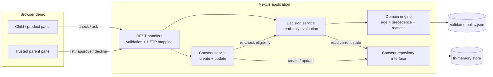
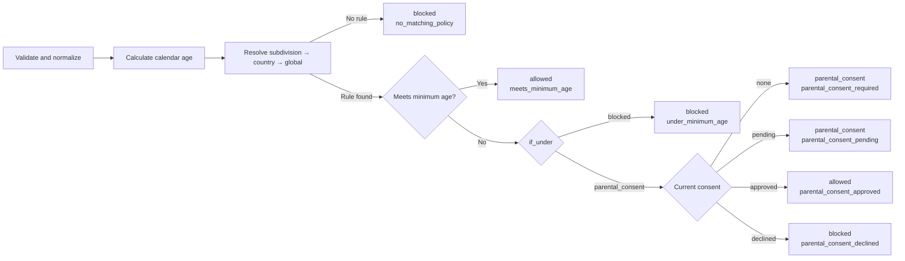
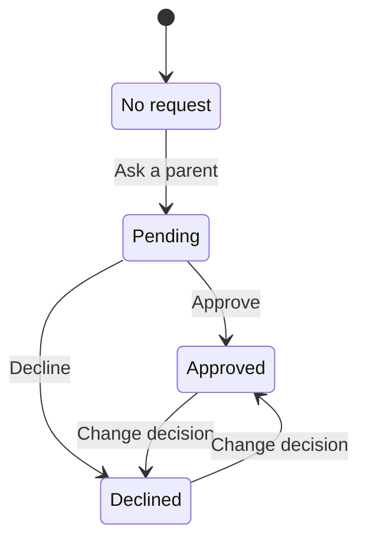
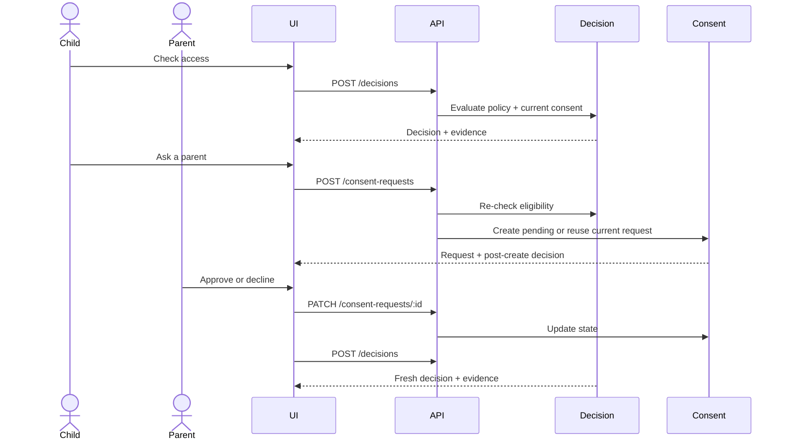
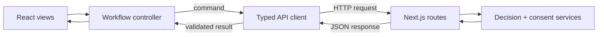

# Consent Gate Design

This document is the implementation contract for the take-home. It describes the delivered behavior; the original prompt is preserved in [`EXERCISE_BRIEF.md`](EXERCISE_BRIEF.md) and choices left open by the prompt are recorded in [`../DECISIONS.md`](../DECISIONS.md). The README records the verified evidence and the delivered capabilities.

## Design in one minute

The design rests on four decisions:

1. **Policy is data.** Ages and under-age actions come from validated JSON, not application conditionals.
2. **Evaluation is read-only.** Checking access never creates a request; **Ask a parent** is the explicit write.
3. **Consent is narrow.** It applies to one subject, jurisdiction, and feature, and only when the winning rule permits consent.
4. **The server explains its answer.** Every result includes a stable reason, lookup path, and matched rule or coverage gap.

Together, these choices keep the important safety property visible:

> **Safety invariant:** parental consent may satisfy a consent-eligible rule, but it can never override a hard block.

## 1. Scope and behavior

Given a subject ID, date of birth, jurisdiction, and feature, the service evaluates calendar age, the most-specific policy rule, and current consent. It returns `allowed`, `blocked`, or `parental_consent`; when consent is eligible, a parent may approve, decline, or reverse the current choice.

**Target slice:** policy validation, deterministic matching, the consent lifecycle, four REST operations, one demonstration page, and focused tests.

**Deliberate cut line:** authentication, guardian relationships, durable storage, notifications, policy administration, and multi-region operation. The parent panel is trusted only to make the workflow visible.

### Selected semantics

The brief's open questions become explicit implementation behavior:

| Question | Behavior |
|---|---|
| Who owns consent? | A stable `subjectId`; two children with the same DOB do not share consent |
| Which rule wins? | `US-CA` beats `US` and `*`, even if it appears later in the JSON |
| What does consent affect? | Only a winning rule whose `if_under` value is `parental_consent` |
| What happens after a decline? | Later checks return `blocked`; the parent may later change to approved |
| Does evaluation create state? | No. **Check access** is read-only; **Ask a parent** is the explicit write |
| What if a declared feature has no matching rule? | Fail closed as `blocked / no_matching_policy` |
| What if the feature is not declared? | Reject the request as invalid input |

### Invariants

These are not implementation preferences. They are the properties a future change must not break:

1. Policy thresholds and actions come only from validated configuration; duplicate `jurisdiction + feature` keys are rejected.
2. Reordering policy rows never changes a decision.
3. Age changes on the calendar birthday, using one injected evaluation date per request.
4. Repeating an access check never creates a consent request.
5. Consent never overrides a hard block.
6. The browser renders server decisions and evidence; it does not implement a second policy engine.
7. Consent for one subject, jurisdiction, or feature never leaks into another scope.

## 2. Architecture

The exercise is one Next.js deployment with explicit internal boundaries. It is not a set of microservices.

Requests enter through one HTTP boundary. Stateless policy logic stays separate from mutable consent state, and both services depend on a repository contract rather than a concrete database.



| Boundary | Responsibility |
|---|---|
| UI | Inputs, progress and error state, result presentation, parent controls |
| REST handlers | Runtime validation, service calls, stable HTTP responses |
| Application services | Decision and consent use cases |
| Domain | Age, policy validation and matching, reason codes, invariants |
| Repository | Current consent state, isolated from policy interpretation |

The in-memory repository is a time-box choice. The interface leaves a clear replacement point without pretending the exercise provides durable or cross-instance state.

### Decision algorithm

For a 15-year-old requesting `chat` in `US-CA`, the evaluator checks `US-CA`, `US`, then `*`; selects the California age-16 rule; and reads consent only because that rule permits it.



Two failure classes remain separate:

- **Invalid policy or input:** duplicate keys, undeclared features, unknown actions, invalid ages, or malformed requests are rejected.
- **Missing coverage:** the policy and request are valid, but no rule applies. The result fails closed as `blocked / no_matching_policy` so operations can detect the gap.

### Consent lifecycle

> **Key distinction:** `pending`, `approved`, and `declined` are persisted consent states. `allowed`, `blocked`, and `parental_consent` are decisions recalculated from policy, age, and the latest state.



One logical record exists for `subjectId + jurisdiction + feature`:

- duplicate creation returns that record rather than opening another lifecycle;
- repeating its current status returns the same representation;
- a reversal changes what the next access check returns.

Creation resolves the consent scope first. If a record already exists, it is returned unchanged as the idempotent result. If none exists, the server evaluates the winning rule without assuming consent and creates a pending request only when that rule is under-age and consent-eligible; otherwise it returns `consent_not_required`. The repository's write reports whether it inserted the record, so the `201`/`200` distinction comes from the write rather than from the earlier lookup.

Audit history and concurrent updates across processes are production concerns, not exercise guarantees.

## 3. API contract

REST fits the four explicit operations. `POST /decisions` keeps DOB out of URLs and does not imply a hidden state change.

`POST /decisions` is a computation despite using POST. `GET /consent-requests` reads state; only consent `POST` and `PATCH` mutate it. Creating a request always re-evaluates eligibility on the server.

| Method | Endpoint | Success |
|---|---|---|
| `POST` | `/api/v1/decisions` | `200`, evaluated decision |
| `POST` | `/api/v1/consent-requests` | `201` when created; `200` when reused |
| `GET` | `/api/v1/consent-requests?subjectId=...` | `200`, requests visible for the active demo subject |
| `PATCH` | `/api/v1/consent-requests/:id` | `200`, current request after approve, decline, or reversal |

### Shared types

These types are the contract between domain, routes, UI, and tests:

```ts
type Decision = "allowed" | "blocked" | "parental_consent";
type ConsentStatus = "pending" | "approved" | "declined";
type DecisionReason =
  | "meets_minimum_age"
  | "under_minimum_age"
  | "parental_consent_required"
  | "parental_consent_pending"
  | "parental_consent_approved"
  | "parental_consent_declined"
  | "no_matching_policy";

type PolicyRule = {
  jurisdiction: string;
  feature: string;
  minAge: number;
  ifUnder: "blocked" | "parental_consent";
};

type Scenario = {
  subjectId: string;
  dateOfBirth: string;   // YYYY-MM-DD
  jurisdiction: string;
  feature: string;
};

type DecisionResult = {
  decision: Decision;
  reason: DecisionReason;
  age: number;
  evaluatedAt: string;      // YYYY-MM-DD
  lookupPath: string[];
  matchedRule: PolicyRule | null;
  consentRequestId?: string;
};

type ConsentRequest = {
  id: string;
  subjectId: string;
  jurisdiction: string;
  feature: string;
  status: ConsentStatus;
  createdAt: string;     // UTC ISO 8601
  updatedAt: string;     // UTC ISO 8601
};
```

`Scenario` is the complete request shape for decision and creation calls. The evaluation date is server-owned: it is injected once per request and is absent from the request body. A request that supplies an evaluation date is rejected as `validation_error` rather than having the value ignored. Jurisdiction input is trimmed and uppercased, then checked for a jurisdiction code shape (`^[A-Z]{2}(-[A-Z0-9]{1,3})?$`); malformed values are `validation_error` and never fall through to `*`. A well-formed but unknown jurisdiction follows the normal lookup and may match `*` or end in `no_matching_policy`.

`policy.json` is the external configuration shape (`min_age`, `if_under`). The loader validates it once and maps it to the camel-case domain type above; routes and UI do not perform their own conversion.

### Response semantics

- `POST /consent-requests` accepts a `Scenario` and returns `{ request, created, decision }`. A new request is `pending`. An idempotent retry returns the existing record unchanged, so an already approved or declined request retains that state and the included decision reflects it.
- `GET /consent-requests?subjectId=...` returns `{ requests }` for the active demo subject.
- `PATCH /consent-requests/:id` accepts `{ status: "approved" | "declined" }` and returns the current `ConsentRequest`.
- The client performs a fresh decision call after a parent action rather than inferring access from the mutation response.

Stable decision reasons are:

| Result | Reason |
|---|---|
| `allowed` | `meets_minimum_age`, `parental_consent_approved` |
| `blocked` | `under_minimum_age`, `parental_consent_declined`, `no_matching_policy` |
| `parental_consent` | `parental_consent_required`, `parental_consent_pending` |

### Errors

Errors use `{ "error": { "code": string, "message": string } }`. Reason codes explain valid decisions; error codes explain why a request could not be processed.

| Status | Code | Use |
|---:|---|---|
| `400` | `validation_error` | Malformed JSON, invalid/implausible/future date, invalid jurisdiction, missing field, unknown feature, client-supplied evaluation date, invalid status |
| `404` | `request_not_found` | Consent request ID does not exist |
| `409` | `consent_not_required` | Current policy does not permit creating a consent request |
| `503` | `dependency_unavailable` | Required consent state cannot be read or written safely |
| `500` | `internal_error` | Unexpected failure; internal details are never returned to the client |

`no_matching_policy` is a successful, fail-closed decision, not an HTTP error.

Error classification is structural: the stable `name` plus the closed set of domain codes, not `instanceof`. The route handler and the services may be bundled separately, so the same error class can exist as two different constructors.

## 4. Product contract

The page places the child/product and trusted-parent experiences together so a reviewer can observe the whole state transition. It does not suggest that a production child and parent share one authenticated screen.

A reviewer should be able to see the input, current decision, parent-controlled state, and winning policy rule without opening developer tools.

```text
┌──────────────────────────────────────────────────────────────────┐
│ Demo cases: expected outcome + purpose                           │
├───────────────────────────────┬──────────────────────────────────┤
│ Child / product               │ Trusted parent                   │
│ Scenario + Check access       │ Current request                  │
│ Decision + reason + evidence  │ Approve / Decline / reverse      │
│ Ask a parent when eligible    │                                  │
├───────────────────────────────┴──────────────────────────────────┤
│ Policy reference: lookup path + highlighted rule + full table    │
└──────────────────────────────────────────────────────────────────┘
```

The Next.js server loads the validated JSON policy and passes a display-safe model to the page. The decision response supplies `lookupPath` and `matchedRule`; the browser only renders them.

### Main interaction

The sequence highlights the side-effect boundary: the first call computes; the second creates state; a parent action changes state; the final call recomputes the answer.



### Visible states and actions

Decision and consent are separate state dimensions. The child panel follows the decision:

| Decision | Child panel | Child action |
|---|---|---|
| Not evaluated | Scenario inputs and, for a preset, its expected result | **Check access** |
| `allowed` | Result, reason, age, lookup path, and matched rule | None |
| `blocked` | Result, reason, lookup path, and matched rule or coverage gap | None |
| `parental_consent`, no request | Result, reason, and matched rule | **Ask a parent** |
| `parental_consent`, request pending | **Waiting for parent** | None |

The parent panel follows the current request:

| Consent status | Parent panel | Parent action |
|---|---|---|
| No request | Empty state | None |
| `pending` | Scoped request and current status | **Approve** or **Decline** |
| `approved` | Approved state | Change to **Decline** |
| `declined` | Declined state | Change to **Approve** |

During a request, the relevant action is disabled. Recoverable errors preserve the scenario and allow retry. Expected preset metadata never drives the decision, and manual input changes clear both the previous result and the preset expectation.

### Accessibility

- Use native controls with programmatic labels; every input and select has a visible label.
- Demo cases are buttons; the selected case exposes `aria-pressed`, and its expected outcome is visible text, never colour alone.
- A concise, visually hidden live region announces the decision summary; progress uses `role="status"`, and the parent status is polite-live.
- Colour is supplementary: every decision and status also carries text and its stable reason or status code.
- Keyboard operation and a visible focus ring are required; the active action and scenario inputs are disabled while a request is in flight.
- Errors use `role="alert"`; the policy table has a caption and column headers.
- On narrow screens the child panel precedes the parent panel.
- Decision cards use four layers with decreasing emphasis: outcome headline, status/next action, evidence list, and a demo check.
- Tag and status text meets WCAG AA contrast (4.5:1) and is at least 0.72rem; colour is never the only signal.
- The parent panel lists other consent scopes for the same subject, and **New subject** resets the synthetic identity without touching the server.
- The page title is two deliberate lines; the second sentence carries the accent colour.
- Key controls expose an inline help button: a focusable trigger with `aria-describedby`, a `role="tooltip"` panel shown on hover and focus, and the same copy available to assistive technology.


### Demo cases

| Preset | Expected | Evidence |
|---|---|---|
| US adult purchase | `allowed` | Age threshold met |
| German child chat | `parental_consent` | Full consent and reversal loop |
| British child chat | `blocked` | Exact hard block beats global consent rule |
| California teen chat | `parental_consent` | Subdivision beats country and wildcard |
| Texas minor video | `blocked` | Subdivision-specific feature block |
| Underage profile photo | `blocked` | Global fallback |
| US teen purchase | `parental_consent` | Feature-specific threshold |
| Missing coverage | `blocked` | Distinct `no_matching_policy` reason |

Selecting a preset generates a fresh synthetic subject, so an earlier decision cannot contaminate the walkthrough. Expected metadata is presentation-only; a contract test evaluates every preset against the real engine. Presets carry an age rather than a fixed date of birth: the page is rendered per request with the server's evaluation date and derives each DOB from it, so the advertised outcome does not drift as the calendar advances.

### Frontend architecture

The server component renders the page shell, the display-safe policy, and the current evaluation date. React owns only interactive workflow state; API routes validate input and call application services. The browser never runs the policy matcher.

| Choice | Responsibility and reason |
|---|---|
| Next.js App Router | One deployment for the server-rendered shell and explicit API routes |
| React client components | Scenario, decision, and parent interactions that share session state |
| TypeScript | Exhaustive request, response, and UI-state contracts |
| Zod | Runtime validation where external input enters the application |
| Semantic HTML and CSS | Accessible, responsive presentation without a component-framework dependency |



One reducer or focused controller hook is enough; Redux or a client cache would add synchronization rules without solving a problem this page has.

#### State and data flow

The client separates editable input from server-evaluated state:

| State | Meaning |
|---|---|
| `draftScenario` | Current form values; changing them invalidates visible results |
| `activeScenario` | Immutable snapshot submitted by the latest operation |
| `decision` | Latest server result for the active scenario |
| `consentRequest` | Server-owned request for the active consent scope |
| `phase` | `idle`, `checking`, `creating_request`, or `updating_request` |
| `error` | Recoverable error from the latest operation |

Data moves in one direction: **user action → controller → API → validated result → state transition → render**. Components receive state and callbacks rather than fetching independently. Each operation captures the active scenario and a request token; input changes clear stale results, cancel old requests when possible, and ignore any late response with an obsolete token.

Actions are derived from the decision and consent status instead of scattered booleans. Parent controls remain bound to the active subject and scope. Controls are labelled and keyboard accessible, focus is visible, status changes are announced without relying on color, and the child panel stacks before the parent panel on narrow screens.

#### Performance and interaction

This page has little data, so interaction correctness matters more than render micro-optimization.

| Concern | Approach |
|---|---|
| Initial load | Server-render the shell and policy; ship no large UI or state library |
| Decision check | One request with immediate progress feedback; no polling or page refresh |
| Rapid input changes | Cancel or ignore stale requests |
| Repeated commands | Disable the active action; retain server idempotency as the final guard |
| Parent decision | Wait for confirmation, then run one fresh decision check |
| Rendering | Add memoization only if measurement finds expensive repeated work |

Approve and decline are not optimistic updates. Consent is enforcement state, so the UI waits for server confirmation before showing the resulting access decision.

## 5. Verification

Each risk is tested at the narrowest useful layer. Tests pin the evaluation date in-process; the request contract exposes no evaluation-date seam. The environment override is honored only when `CONSENT_GATE_ALLOW_TEST_CLOCK=1`, so an accidental deployment variable cannot freeze production dates.

> **Testing principle:** prove business rules close to the domain, prove boundaries once, and reserve browser tests for journeys whose wiring matters.

| Layer | Proves | Representative cases |
|---|---|---|
| Unit, Vitest | Pure domain behavior | birthdays, policy validation, order-independent precedence |
| Service integration, Vitest | Policy and consent together | create/reuse, approve, decline, reversal, hard-block invariant |
| API integration, Vitest | Validation and HTTP mapping | malformed input, status codes, complete route lifecycle |
| Demo contract, Vitest | UI metadata matches policy | all presets produce their advertised result |
| E2E, Playwright | Browser, API, services, and state are wired together | consent loop, precedence evidence, hard block versus missing coverage |

### Highest-risk cases

- **Policy:** duplicate keys, shuffled rows, undeclared features, missing coverage.
- **Age:** invalid or future dates, the day before/on/after a birthday, February 29.
- **Consent:** duplicate creation, repeated actions, reversal, hard-block protection, scope isolation.
- **UI:** stale responses, double submission, failed API calls, and repeatable demo presets.

Frontend verification should also cover the action matrix: hard blocks never expose **Ask a parent**, pending requests cannot be recreated, and only the active subject's request can be changed. Playwright covers the full journey; pure selectors or state transitions should be tested below the browser layer when they contain branching behavior.

Tests should not repeat every policy permutation at every layer.

### Failure semantics

Failures must not silently become access decisions. The exercise and its production direction use the following defaults:

| Failure | Behavior |
|---|---|
| Policy cannot load or validate | Fail build or startup; never serve decisions from unknown rules |
| Invalid decision input | Return the stable `validation_error` contract; do not create state |
| Decision request fails | Preserve the scenario, show a retryable error, and never infer `allowed` |
| Consent state cannot be read | Return `503 / dependency_unavailable`; do not manufacture a business decision |
| Consent command is repeated | Return the existing logical request or current target state |
| Parent update succeeds but decision refresh fails | Keep the confirmed request state visible and allow the decision check to be retried |
| An older browser response arrives late | Ignore it because it no longer matches the active request token |

The in-memory exercise repository has no external availability failure, but the service contract must not assume that a durable production repository is infallible.

### Requirement traceability

Before submission, each requested deliverable must have visible evidence. This table maps each requirement to the tests and documents that provide that evidence.

| Brief requirement | Evidence required at handoff |
|---|---|
| Decision endpoint | Route tests plus a successful browser decision |
| Parent approve, decline, and reversal | Service tests and one complete Playwright journey |
| Answers stay right | Precedence, birthday, scope-isolation, and hard-block regression tests |
| A couple of meaningful tests | Non-empty suites at the layers above; CI must fail when they fail |
| `DECISIONS.md` | Final choices, rationale, trade-offs, and skipped work match the code |
| `AI-USE.md` | Actual tools, accepted contributions, rejected output, and corrections |
| README run instructions | Clean install, build, test, and start verified from the reviewed commit |

## 6. Production boundary

The exercise does not claim durable consent, guardian authorization, cross-instance concurrency, or production availability. [`PRODUCTION_NOTES.md`](PRODUCTION_NOTES.md) describes the smallest credible evolution for those concerns without expanding the target implementation.
