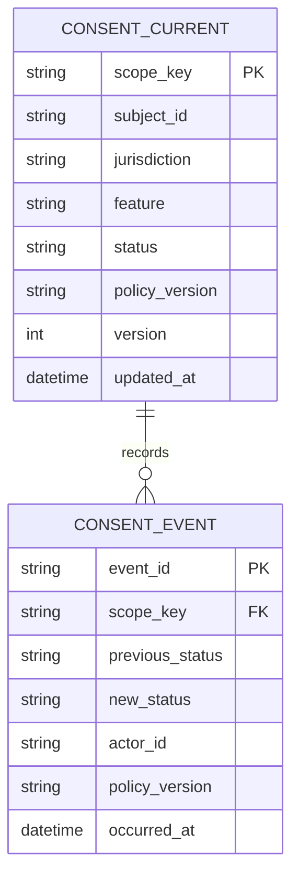
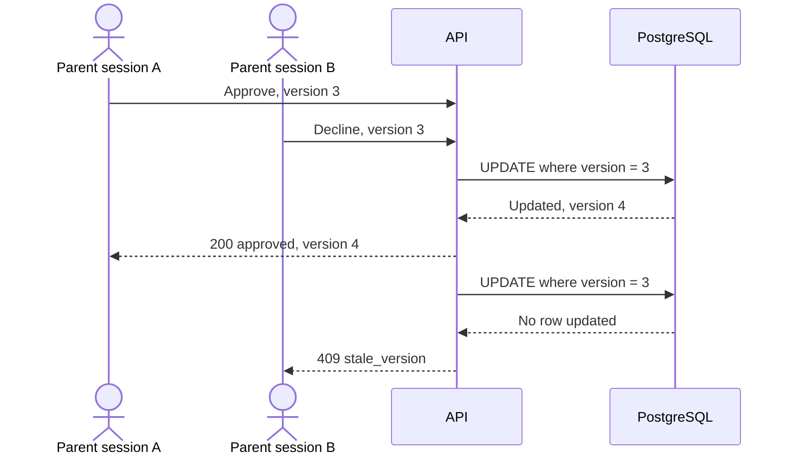
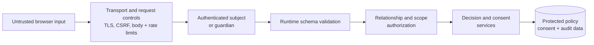
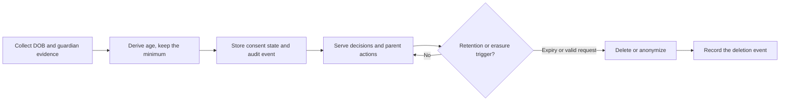

# Production Notes

> **Status:** design direction only. None of the controls in this document are claimed as part of the exercise implementation unless the README later records and verifies them.

The exercise intentionally uses trusted demo identities and in-memory state. A production consent service would change the trust, storage, and operating model without moving policy semantics into routes or clients.

| Exercise | Production |
|---|---|
| Synthetic `subjectId` and trusted parent panel | Authenticated subject and verified guardian-subject relationship |
| In-memory current state | PostgreSQL current state plus immutable audit events |
| One process | Unique constraints, transactions, and optimistic concurrency |
| One JSON policy shipped with the app | Versioned policy, controlled activation, effective dates, and re-consent rules |
| Test and application output | Privacy-safe telemetry, alerts, rate limits, tracing, and rollback |

## Durable state

Keep the enforcement-path projection separate from its history:

`CONSENT_CURRENT` supports fast decisions. `CONSENT_EVENT` records who changed the state, when, and under which policy. The current-state row should also snapshot the age and rule used at approval, so a later policy change can explain the original decision. Updating both belongs in one transaction. The final scope may also include product, purpose, guardian relationship, and expiry; those require product and legal decisions. The event table is append-only and access-controlled. If audit must be tamper-evident, chain event hashes or export signed batches. Retention and deletion rules apply to events as well as current state.

## Migration and rollout

Moving from the exercise to a durable store is a staged change, not a swap:

- **Schema.** Create expand-only migrations and keep the application compatible with old and new columns during the rollout.
- **Backfill.** Replay existing scopes, then shadow-read from PostgreSQL while the in-memory path still serves decisions.
- **Cutover.** Move writes behind a flag and keep a rollback path to the last known-good revision.
- **Reconcile.** Compare counts and sampled records before deleting the old path.
- **Recovery.** Run restore drills; a backup that has never been restored is not a recovery plan.

## Idempotency and concurrent writes

Business idempotency and request idempotency solve different problems. A unique scope plus transactional upsert prevents duplicate logical requests. An `Idempotency-Key` becomes useful when a retried command also emits events or sends notifications. Scope the key to the actor and operation, store it with the response, and expire it after a bounded window; a retry with the same key returns the stored result instead of re-executing the command.

Repeating `approve` on an approved request is harmless. Simultaneous `approve` and `decline` commands conflict and should use a version check:

The second parent must read the latest state and choose again. Silent last-write-wins is inappropriate for consent. `409 stale_version` is a production-specific code; the exercise uses `409 consent_not_required` for a different condition.

Current consent is consistency-sensitive. If storage is unavailable for a consent-eligible decision, withhold access and return an availability error; never grant access from an unverified stale approval. Analytics and notifications may be eventually consistent.

Keep notifications off the enforcement path. If audit publication or notifications become asynchronous, use a transactional outbox so a committed parent action cannot lose its event.

## Policy lifecycle

- Treat DOB as a calendar date and use one explicit evaluation date per decision. Store operational timestamps in UTC.
- Give policies versions and effective dates; define whether a change invalidates existing consent.
- Give every production rule a stable identifier for audit and telemetry.
- Require review and approval for policy changes, validate them in staging, and roll out with a canary and a rollback plan.
- Fail readiness when the startup policy is invalid. Reject an invalid replacement and continue serving the last known valid version.
- Report the active policy version so drift between instances can be detected.
- Model jurisdiction inheritance explicitly. The exercise's `subdivision → country → *` lookup must not be assumed to cover every legal hierarchy.

Consent validity over time is a product and legal decision, not a storage detail:

| Change | Decision required before production |
|---|---|
| Minimum age or under-age action changes | Decide whether existing consent remains valid or requires re-consent |
| Subject moves jurisdiction | Re-evaluate under the new jurisdiction; do not silently reuse differently scoped consent |
| Feature purpose materially changes | Decide whether purpose belongs in the consent scope and whether re-consent is required |
| Consent reaches an expiry date | Withhold access until the required consent is renewed |
| Account or guardian relationship ends | Revoke enforcement state and apply the approved retention policy to audit history |

A policy version makes the original basis auditable. A version change should not automatically invalidate approvals; the policy owner defines compatibility rules for each change.

## Trust and security boundary

In production, authentication establishes who the actor is; authorization separately proves that the actor may view or change consent for this subject and scope. Browser-provided identity, guardian claims, and subject attributes must be authenticated or verified before enforcement.

Authorization is object-level: every read and write is checked against the authenticated actor's relationship to this subject and scope. Do not rely on unguessable IDs as the only control; rate-limit lookups and audit access.

Guardian verification should match the risk: an identity or payment-card check, a signed invitation from a verified guardian, or step-up authentication for high-impact changes. Record the method and time, support multiple guardians, and define how their conflicting decisions are resolved.

The browser may display decision evidence, but it never becomes an enforcement point. Policy, guardian relationships, and consent remain server-owned. DOB and consent history are sensitive data: minimize collection, keep them out of URLs and routine logs, restrict audit access, and define deletion and retention rules with legal and privacy owners.

## Privacy and data lifecycle

DOB and consent history identify a child. The lifecycle is collect, derive, store, use, then delete, with access and correction available throughout.

| Data class | Examples | Handling |
|---|---|---|
| Age evidence | DOB | Derive age; avoid retaining raw DOB when birth year or age is enough |
| Consent state | scope, status, policy version | Keep while active; delete or anonymize on expiry or erasure, subject to legal hold |
| Audit events | actor, time, status change | Append-only, access-controlled; retention follows legal policy |
| Guardian evidence | verification method and time | Store the result, not identity documents; restrict access |
| Telemetry | request ID, outcome, latency | No DOB or guardian PII; aggregate where possible |

Cross-cutting rules:

- Keep PII out of URLs, logs, traces, and error messages.
- Encrypt in transit and at rest; rotate keys and restrict decrypt access.
- Support subject and guardian access and correction requests, and log who accessed audit data.
- Separate duties: policy changes require an approver other than the author, and audit access is reviewed.

## Operations

Decision telemetry should include request ID, policy version, stable rule identifier, outcome, reason, latency, and error category, without raw DOB. Monitor decision failures, `no_matching_policy`, consent completion, stale-version conflicts, storage failures, and policy-version drift.

Deployment should preserve a last known-good revision. Liveness confirms that the process runs; readiness confirms that required policy and storage are available. The take-home deployment proves only that its tested path builds, starts, and responds.

Production operations also need:

| Area | Control |
|---|---|
| Reliability | SLOs and alerts for decision latency and errors, consent completion, stale-version conflicts, storage failures, and policy-version drift |
| Recovery | Backups with a defined RPO and RTO, regular restore drills, and a documented rollback path |
| Abuse | Rate limits and per-actor quotas on lookup and write endpoints |
| Secrets | Key rotation, secret management, and access reviews for policy and consent data |
| Incidents | Runbooks for a storage outage, a policy rollback, and a suspected guardian-account compromise |
| Scale | Load and failover testing; multi-region only with an explicit consistency model |
| API | A versioned API with a deprecation window and stable reason and status codes |
